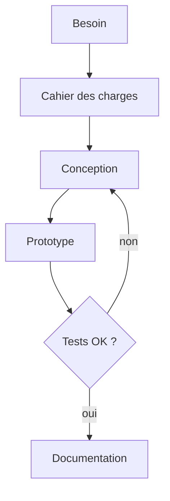

Copie-colle les exemples ci-dessous dans n'importe quelle page (projet, article, doc).
Chaque outil est **open source** ; le lien renvoie à sa documentation officielle.

## Encadrés

``



## Icônes — [Lucide](https://lucide.dev/icons/)

`` →    

Cherche le nom d'une icône sur [lucide.dev/icons](https://lucide.dev/icons/).

## Graphiques — [Chart.js](https://www.chartjs.org/docs/latest/)

``



Pour plusieurs séries, place les données dans `_data/mesures.yml` (voir le guide, partie 6) puis :
``



## Diagrammes — [Mermaid](https://mermaid.js.org/intro/)

Écris simplement un bloc de code avec le langage `mermaid` :



## Modèles 3D — [model-viewer](https://modelviewer.dev/docs/)

``



## Électronique KiCad — [KiCanvas](https://kicanvas.org/)

``



## Vidéos

`` ou `fichier="/assets/videos/demo.mp4"`.

## Code

```cpp
void loop() {
  int capteur = analogRead(A0);
  Serial.println(capteur);
}
```

## Couleur du site

Pas d'include ici : la couleur se règle pour tout le site, d'une ligne dans `_config.yml`.

```yaml
couleur: bleu          # rouge, bleu, vert, violet, orange, turquoise, rose, gris
couleur: "#0057b8"     # ou un code libre, entre guillemets
```

Palette complète, feuille de style personnelle (`assets/css/perso.css`) et remplacement d'un morceau du thème : voir la [partie 10 du guide étudiant]({{ '/docs/guide-etudiant/' | relative_url }}#10-personnaliser-lapparence-optionnel).

## Tableaux

| Composant | Quantité | Prix |
|---|---|---|
| ESP32 | 1 | 8 € |
| Moteur N20 | 2 | 6 € |
