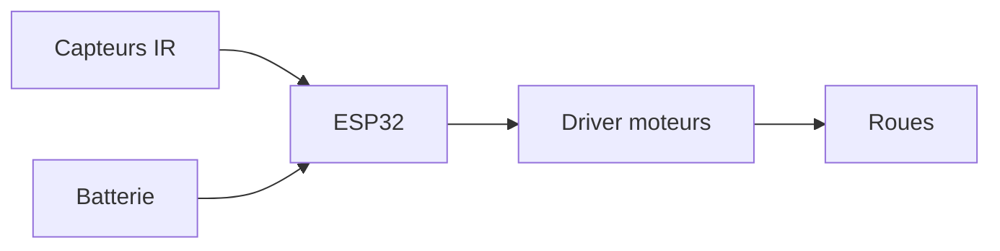

## Contexte

Pourquoi ce projet ? Dans quel cadre (cours, club, perso) ? Quel était le besoin ?

## Mon rôle

Ce que **j'ai** fait personnellement dans l'équipe (c'est ce qui justifie tes compétences).

## Démarche

### Cahier des charges

| Exigence | Critère | Validation |
|---|---|---|
| Suivre la ligne | écart < 1 cm | test sur piste |
| Autonomie | > 20 min | chronomètre |

### Architecture

### Conception mécanique



## Résultats



## Ce que j'en retiens

Difficultés rencontrées, ce que je ferais différemment, ce que j'ai appris.
